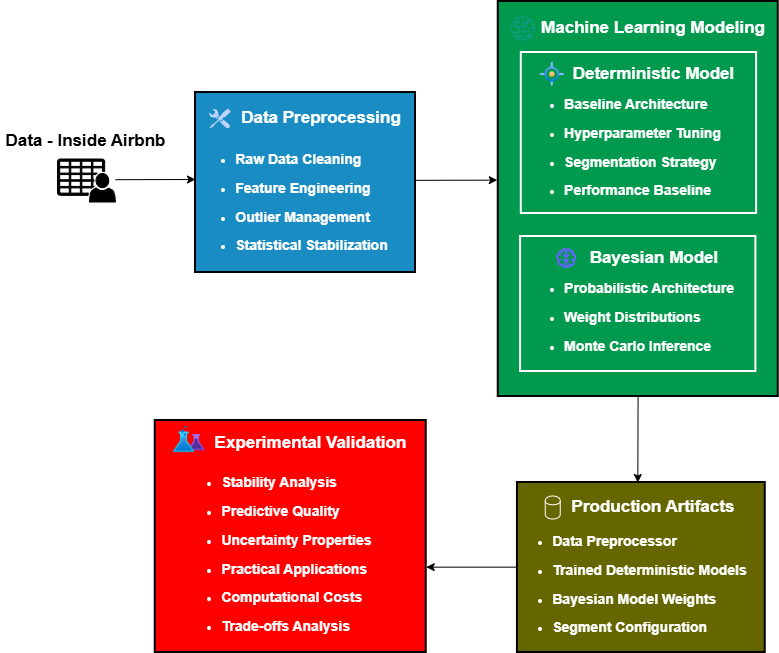

# Implementation, Experimentation, and Comparative Analysis of Deterministic and Bayesian Neural Networks using TensorFlow Probability

This project has been developed as part of a Bachelor's Thesis (*Trabajo de Fin de Grado*) for the completion of a Degree in Mathematics at the *Escuela Técnica Superior de Ingeniería Informática* of Universidad Rey Juan Carlos.

**Author:** José Jesús Durán Quintana

**Supervisor:** Juan Manuel Serrano Hidalgo

## Summary

This repository hosts the source code and experimental framework for a Bachelor's Thesis focused on the design, implementation, and comparative analysis of **deterministic** and **Bayesian** neural networks.



Applied to the prediction of vacation rental prices, the project explores the transition to Bayesian neural networks using **TensorFlow Probability** to capture both epistemic and aleatoric uncertainty. Through a rigorous empirical evaluation that contrasts this approach with deterministic models in terms of predictive accuracy and computational cost, the study analyzes practical applications—such as the selective rejection of doubtful predictions and geographical generalization—to establish a comprehensive trade-off analysis that defines the optimal use cases for real-world decision-making.

The complete theoretical background, mathematical formulations, and extensive experimental results are documented in the Bachelor's Thesis report, available at [docs/report/final_project_report.pdf](docs/report/final_project_report.pdf).

## Table of Contents

- [Project Objectives](#project-objectives)
  - [General Objective](#general-objective)
  - [Specific Objectives](#specific-objectives)
- [Setup and Installation](#setup-and-installation)
- [End-to-End Execution](#end-to-end-execution)
- [Experimental Model Pipeline](#experimental-model-pipeline)
  - [Data Analysis and Problem Description](#data-analysis-and-problem-description)
  - [Preprocessing Pipeline](#preprocessing-pipeline)
  - [Deterministic Modeling](#deterministic-modeling)
  - [Bayesian Modeling](#bayesian-modeling)
- [Production Model Pipeline](#production-model-pipeline)
- [Experimental Evaluation](#experimental-evaluation)
  - [Monte Carlo Convergence and Stability Analysis](#monte-carlo-convergence-and-stability-analysis)
  - [In-Depth Uncertainty Analysis](#in-depth-uncertainty-analysis)
  - [Cross-City Pipeline Generalization](#cross-city-pipeline-generalization)
  - [Computational Costs](#computational-costs)
- [Utility Scripts](#utility-scripts)

## Project Objectives

### General Objective

Design, implement, and comparatively analyze deterministic and Bayesian neural network architectures using TensorFlow Probability, applied to price prediction in the vacation rental market. The primary purpose is to empirically evaluate the impact of uncertainty quantification versus point estimates, thereby establishing a trade-off analysis to determine the optimal use cases for each paradigm in decision-making.

### Specific Objectives

#### Development of a Deterministic Reference Model

Implement a data engineering methodology aimed at transforming raw and heterogeneous information into high-quality structures, ensuring that the data are suitable for the training and optimization of deep neural networks applied to Airbnb price prediction. This process encompasses the cleaning, normalization, and technical encoding of variables, upon which a classical architecture will be designed and trained in TensorFlow using point estimation. The purpose of this phase is to guarantee the stability and reproducibility of the learning process, thereby establishing the reference model necessary for subsequent comparison of results.

#### Implementation of the Bayesian Model

Develop a Bayesian neural network architecture using the probabilistic programming library TensorFlow Probability. Building upon the data processing pipeline and topology defined in the previous objective, the classical paradigm will be transformed by replacing static weights with probability distributions that capture parameter uncertainty. By using variational inference techniques to approximate the posterior distribution, the objective is to provide the system with an intrinsic capability to quantify the uncertainty associated with its predictions, enabling a probabilistic output rather than a single point estimate.

#### Comparative Experimental Evaluation and Trade-off Analysis

Conduct an empirical experimentation phase to contrast the behavior of the deterministic and Bayesian paradigms across various evaluation dimensions within the Airbnb scenario. This comparison will integrate the analysis of predictive performance and result consistency with the study of uncertainty properties, evaluating fundamental aspects such as calibration and robustness to outliers. Furthermore, the performance of both models will be analyzed from an efficiency perspective, measuring the impact on execution time and resource consumption. The ultimate goal is to perform a trade-off analysis that identifies the optimal use cases for each approach based on the specific requirements of each scenario.

## Setup and Installation

This section provides a step-by-step guide to setting up your local environment to run the design and training of the models, and the subsequent experimentation phase.

**1. Prerequisites**

Ensure you have the following software and resources available to run the project:

  * **Git:** For cloning the repository.
  * **Python:** Version 3.10 or higher.
  * **Data:** The raw datasets are not included in the repository. You will need to download and unzip the `listings.csv.gz` files from [Inside Airbnb](http://insideairbnb.com/get-the-data/) for the studied cities and place them in their respective `data/` subdirectories: `data/madrid/listings.csv`, `data/barcelona/listings.csv`, `data/tokyo/listings.csv`, and `data/mexico-city/listings.csv`.
  * **Hardware (Recommended):** Due to the computational demands of Bayesian Neural Networks, a modern multi-core CPU and at least 16GB of RAM are highly recommended. A TensorFlow-compatible GPU will significantly speed up training.

**2. Clone the Repository**

Clone this repository to your local machine:

```powershell
git clone https://github.com/josedq/deterministic-bayesian-nn-tensorflow-probability.git
cd deterministic-bayesian-nn-tensorflow-probability
```

**3. Set up the Python Environment**

All Python scripts should be run within a virtual environment.

```powershell
# Create a virtual environment (e.g., named 'venv')
# On Windows (Powershell)
py -3.10 -m venv venv
# On macOS/Linux (Bash/Zsh):
# python3 -m venv venv

# Activate the virtual environment
# On Windows:
.\venv\Scripts\Activate.ps1
# On macOS/Linux:
# source venv/bin/activate

# Install all required Python packages
pip install -r requirements.txt
```

## End-to-End Execution

This section provides the complete step-by-step instructions to run the entire modeling and experimentation pipeline from scratch. To read more specific details about a particular step, visit the corresponding section.

**1. Set up the Environment**

Follow the instructions in the [Setup and Installation](#setup-and-installation) section to clone the repository, download the required datasets into the `data/` folder, and activate your Python virtual environment.

**2. Train the Production Models**

Run the production pipeline to train both the deterministic and Bayesian models across all defined price segments. This script creates the preprocessor, trains the networks, evaluates them on a test split, and saves the resulting `.keras` and `.h5` artifacts to the `artifacts/` directory.

```powershell
python src/production_training.py
```

**3. Run the Monte Carlo Convergence and Stability Analysis**

Validate the stability of the Bayesian model by evaluating MAE and simulation error across different sample sizes.

```powershell
python src/exp01_mc_inference_stability.py
```

**4. Run the Predictive Quality & Uncertainty Analysis Suite**

Execute the consolidated test suite that deeply analyzes the predictive performance, correlation between error and uncertainty, calibration properties, Out-Of-Distribution  detection capabilities, and practical application rules for rejecting highly uncertain predictions.

```powershell
python src/exp02_07_uncertainty_suite.py
```

**5. Run the Cross-City Generalization Study**

Test how well the modeling approach generalizes to other real estate markets. This script trains new models from scratch for Barcelona, Tokyo, and Mexico City, comparing their deterministic and Bayesian Mean Absolute Percentage Errors (MAPE) against the Madrid baseline.

```powershell
python src/exp08_multi_city.py
```

**6. Run the Computational Cost Analysis**

Evaluate the inference latency, batch throughput, memory footprint, and model sizes of the deterministic vs. Bayesian models. Note: This script automatically triggers two background benchmarks (`train_det_benchmark.py` and `train_bay_benchmark.py`) to measure the resource footprint (CPU/RAM) during training.

```powershell
python src/exp09_cost_analysis.py
```

**7. Analyze the Results**

All generated performance metrics, detailed CSV tables, and JSON evaluation reports are saved in the `results/training/` and `results/experiments/` folders. You can use these files to build your own visualizations or cross-reference the exact performance figures reported in the thesis report.

## Experimental Model Pipeline

The experimental work is structured into a series of Jupyter Notebooks located in `docs/notebooks/`, each corresponding to a logical phase of the research and model development lifecycle. This exploratory phase defined the preprocessing logic and established the foundation for the production scripts.

### Data Analysis and Problem Description

`01_analysis.ipynb`

Performs an exploratory analysis to understand the dataset's structure and quality. It calculates missing value percentages and visually inspects the target variable (`price`) using histograms and boxplots. Crucially, it identifies severe right-skewness and extreme outliers, leading to the formal definition of the problem: restricting the predictive scope to properties under €249 (the vast majority of the real estate market). It concludes by categorizing and selecting the relevant input features (Location, Property Structure, Host Profile, and Reputation metrics).

### Preprocessing Pipeline

`02_preprocessing.ipynb`

Implements the complete data transformation methodology. It performs robust data cleaning by dropping high-cardinality IDs, unstructured text, and redundant temporal variables. The core component is the construction of a Scikit-learn `ColumnTransformer` that enforces strict data types, applies median imputation for missing numericals alongside `StandardScaler`, and applies One-Hot Encoding to categorical variables. The resulting `preprocessor.pkl` and intermediate datasets are exported to guarantee deterministic reproducibility in all subsequent stages.

### Deterministic Modeling

`03_deterministic_modeling.ipynb`

Serves as the architectural testbed to establish the predictive baseline. The notebook is split into two critical experiments:
1. **Architecture Ablation Study:** Systematically compares variations in network depth (2 to 4 layers), width, and activation functions (`relu`, `tanh`, `sigmoid`) to find the optimal Multi-Layer Perceptron (MLP) topology.
2. **Segmentation Strategy:** Empirically proves that fitting independent models to distinct price brackets (e.g., 5 specific segments) dramatically reduces the global Mean Absolute Error (MAE) compared to a single monolithic model.

It concludes by training the optimal architecture across the 5 defined segments and saving the production-ready `.keras` artifacts.

### Bayesian Modeling

`04_bayesian_modeling.ipynb`

Translates the optimized deterministic architecture into the probabilistic paradigm. It constructs the network using TensorFlow Probability's `DenseFlipout` layers, calculating the strict Kullback-Leibler divergence weight (`1 / n_train`) necessary for robust Variational Inference, and optimizing the Negative Log-Likelihood. The notebook iteratively trains independent Bayesian models for each of the 5 price segments. Crucially, it evaluates the probabilistic outputs by plotting Monte Carlo prediction intervals (mean ± 2σ) and performing heteroscedasticity checks before exporting the final `.h5` weights.

## Production Model Pipeline

The findings identified during the experimental phase have been consolidated into a single automated script. This script executes the entire end-to-end training pipeline efficiently, ensuring consistency and generating all necessary artifacts for the subsequent experimentation suite.

`production_training.py`

This script serves as the definitive workflow for training both the deterministic baselines and the probabilistic Bayesian networks. It guarantees strict data leakage prevention and mathematical reproducibility across the 5 predefined property price segments.

**Functionality:**

1.  **Data Loading and Cleaning:** Implements the `load_and_preprocess_data` function, which applies the filters discovered during the exploratory phase (e.g., date calculations, amenity parsing, ordinal mappings).
2.  **Data Splitting:** Partitions the total dataset into a global training set (`1 - TEST_SPLIT_SIZE`) and a held-out test set (`TEST_SPLIT_SIZE`), controlled by a fixed `GLOBAL_SEED`.
3.  **Preprocessor Fitting:** Fits the Scikit-learn preprocessing pipeline (imputation, scaling, encoding) exclusively on the training set to prevent data leakage, subsequently transforming both sets into normalized arrays (`float32`).
4.  **Raw Dataset Serialization:** Exports the exact raw (unprocessed) counterparts of the train and test splits to `listings_production_training.csv` and `listings_production_test.csv`. This is crucial for down-stream Out-Of-Distribution and cross-regional validation tasks.
5.  **Model Training (Deterministic):** Iterates over the 5 defined segments. For each segment, it masks the data within the price bounds, dynamically compiles the standard MLP architecture, and fits it using Early Stopping (`patience=20`) to prevent overfitting.
6.  **Model Training (Bayesian):** For the same bounded segment, it compiles the probabilistic `DenseFlipout` network, applying the segment-specific `n_train` to calculate the exact Kullback-Leibler weight.
7.  **Artifact Serialization:** Upon completion, the script saves a unified suite of components to the `/artifacts` directory:
    * The centralized preprocessing pipeline (`preprocessor.pkl`).
    * The deterministic segment models in native Keras format (`.keras`).
    * The Bayesian segment weights (`.h5`) alongside their structural configuration JSONs (`_config.json`).
8.  **Automated Logging:** Emits real-time training times, parameter counts, and MAE/MAPE validation metrics to the console, and compiles a comprehensive evaluation report saved as both `metrics_summary.csv` and `metrics_summary.json` in the `results/training/` directory.

## Experimental Evaluation

This section documents the 9 core experiments conducted to validate the framework, ranging from theoretical statistical validations to Out-Of-Distribution testing and computational benchmarking. The experiments are organized into four scripts, each demonstrating different capabilities of the deterministic and Bayesian pipelines.

### Monte Carlo Convergence and Stability Analysis

This study evaluates the mathematical stability of the Bayesian inference process by identifying the optimal number of Monte Carlo samples required for reliable uncertainty estimation.

`exp01_mc_inference_stability.py`

The script analyzes the behavior of the model under different inference workloads to determine the threshold where simulation noise becomes negligible. It executes predictions on the test set using incrementally larger sample sizes, ranging from $K=5$ to $K=200$, while monitoring the evolution of the Empirical MAE, the Monte Carlo Standard Error (MCSE), and the Relative MC Error (CV MC). The process generates three output files: a numerical log in `exp01_mc_inference_stability.csv`, a 3-panel visualization of convergence curves in `exp01_mc_inference_stability.png`, and a grid of predictive density plots in `exp01_mc_inference_stability_histograms.png`.

### In-Depth Uncertainty Analysis

This comprehensive suite evaluates the predictive quality, calibration, and practical utility of both the deterministic and Bayesian models across 6 detailed experiments.

`exp02_07_uncertainty_suite.py`

*   **EXP-02 Baseline Predictions Audit:** Conducts a detailed manual audit on an array of 15 random test samples, explicitly selecting 3 from each of the 5 predefined price segments. For every listing, it calculates and displays the deterministic and Bayesian price predictions alongside the real housing price, showcasing the absolute and relative errors committed as well as the expected uncertainty margins (standard deviations). The results are saved into `exp02_audit.csv` and `exp02_audit_plot.png` for human inspection.
*   **EXP-03 Segment-Level Performance Comparison:** Analyzes how the segmentation strategy affects accuracy across different price brackets by breaking down the MAE, MAPE, and RMSE metrics for each of the 5 predefined price segments. A visual comparison of this segment-by-segment performance is saved to `exp03_segments.png`. Also, the metrics are saved in `exp03_segments.csv`
*   **EXP-04 Uncertainty-Error Correlation:** Verifies if the Bayesian model is correctly calibrated by calculating the Spearman rank correlation between the model's absolute prediction error and the predicted standard deviation (uncertainty). A positive correlation, visualized as a hexagonal density plot in `exp04_correlation.png`, indicates that the model correctly assigns higher uncertainty to its more erroneous predictions.
*   **EXP-05 Confidence Interval Calibration:** Evaluates if the probabilistic bounds are statistically sound by calculating empirical coverage—that is, how often the true housing price actually falls within the predicted 95% Confidence Interval. It measures the average width of these intervals across segments, plotting the expected versus empirical coverage in `exp05_calibration_analysis.png`. Additionally, it generates `exp05_calibration_detailed.csv` for detailed coverage across different confidence levels and `exp05_calibration_by_segment.csv` for a detailed segment-by-segment breakdown.
*   **EXP-06 Aleatoric vs Epistemic Decomposition:** Analyzes the sources of uncertainty for different listings by decomposing the total predictive variance into aleatoric (inherent data noise) and epistemic (model ignorance) components. This reveals which type of uncertainty is driving the confidence limits, generating a detailed structural `exp06_uncertainty_decomposition.csv` and a visualization saved as `exp06_uncertainty_decomposition.png`.
*   **EXP-07 Rejection Pipeline Simulation:** Simulates a real-world business application leveraging Bayesian uncertainty by systematically rejecting the predictions with the highest uncertainty percentiles. It evaluates how the Global MAE progressively improves on the accepted subset of predictions, plotting this performance ceiling in `exp07_rejection.png`.

All individual experiment results from EXP-02 through EXP-07 are additionally consolidated into a single machine-readable `summary.json` file saved to `results/experiments/`, enabling programmatic cross-referencing of the full evaluation suite.

### Cross-City Pipeline Generalization

This experiment validates the adaptability of the segmented preprocessing and modeling strategy designed for Madrid, ensuring it can function universally across any given city dataset sharing the exact same columns.

`exp08_multi_city.py`

This script generalizes the entire pipeline (preprocessor and model architectures) so it can directly ingest standard Inside Airbnb datasets. It iteratively trains and tests this generalized strategy from scratch across 4 different real estate markets: Madrid, Barcelona, Tokyo, and Mexico City. By comparing the resulting predictive metrics of the deterministic and Bayesian architectures across all four locations, it proves the framework's universal applicability and robustness against structurally diverse housing distributions. The results are saved into `exp08_multi_city_generalization.csv` and subsequently visualized in multiple comparison plots across the segments (`exp08_multi_city_segment_comparison.png`) and cities (`exp08_multi_city_generalization_summary.png`), including individual training curves for each location (`exp08_{city}_training_curves.png`) to visually demonstrate model convergence and stability.

### Computational Costs

A critical operational benchmark to quantify the infrastructural trade-offs between deterministic speed and probabilistic rigor.

`exp09_cost_analysis.py`

This experiment extensively characterizes the computational resources utilized by both inference engines. To do so, it simulates a production load against the deterministic and Bayesian models using multi-threaded resource monitors. It records the maximum physical RAM usage, mean CPU allocation percentage, latency bottlenecks per segment, and raw throughput (samples per second). The aggregated benchmark results are saved into `exp09_cost_analysis_detailed.csv`, accompanied by granular time-series CSV logs for each model type (`exp09_train_bay.csv`, `exp09_train_det.csv`). Finally, it generates a side-by-side consumption plot (`exp09_resource_usage.png`) that visually details CPU and RAM usage over time.

## Utility Scripts

`data_utils.py`

This module is responsible for loading the raw datasets and executing the core feature engineering pipeline. It cleans and transforms data by parsing amenities lists into counts, calculating the number of days elapsed since critical dates (like the host's joining date or past reviews), mapping boolean text flags (`t`/`f`) to binary integer values (1/0), and filtering outlier property prices above the configured threshold.

`logger_config.py`

This script provides a centralized setup for the Python `logging` module. It ensures that all scripts emit logs with a uniform format (including timestamps and severity levels) to the console, making the tracking of complex model training processes and experimental evaluations much easier.

`model_io.py`

This file contains crucial logic to safely save and load models, particularly across different TensorFlow/Keras versions. It implements a compatibility patch (`patch_input_layer_compat`) to fix legacy `batch_shape` serialization issues when loading old saved models. It also provides the `load_det_from_keras_zip` utility to bypass config deserialization entirely by extracting weights directly from the internal `.h5` file inside modern `.keras` archives.

`models.py`

This module defines the neural network architectures used in the project. It explicitly builds the deterministic Multi-Layer Perceptron with standard `Dense` and `Dropout` layers. Additionally, it constructs the Bayesian Neural Network by stacking TensorFlow Probability's `DenseFlipout` layers and applying an independent Normal distribution over the output, with the Kullback-Leibler divergence weight explicitly defined for variational inference.

`monitoring.py`

This lightweight script provides the `resource_monitor` function, which is designed to run in a background thread using `psutil`. It periodically samples and records the CPU usage and memory footprint of the active Python process. This is specifically used by the benchmark training scripts to profile computational overhead in real-time.

`preprocessing.py`

This file encapsulates the `scikit-learn` `ColumnTransformer` preprocessing pipeline. It defines how different data types should be treated before entering the neural network: numerical variables with missing values are median-imputed, standard numerical counts are scaled via `StandardScaler`, and categorical strings undergo one-hot encoding. This ensures exact consistency in the data representation between training and inference environments.

`train_det_benchmark.py` / `train_bay_benchmark.py`

These two sibling scripts are automatically invoked by `exp09_cost_analysis.py` to profile the computational resources consumed during a full training run. Each script independently trains the corresponding model type (deterministic or Bayesian) for all price segments while a background thread using `psutil` periodically samples CPU usage and RAM footprint. The resulting time-series measurements are saved to `results/experiments/exp09_train_det.csv` and `results/experiments/exp09_train_bay.csv` respectively, which are subsequently read and visualized by the cost analysis experiment.

`config/constants.py`

This file serves as the centralized configuration source for the entire pipeline. It defines immutable parameters like random seeds, train/test split fractions, target variable names, upper price caps, feature categorizations, predefined price segments for clustered training, and visual color palettes. Keeping these centralized ensures experiments are absolutely reproducible across different execution sessions and modules.
